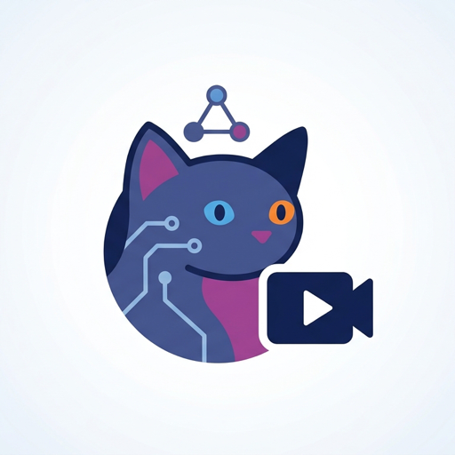
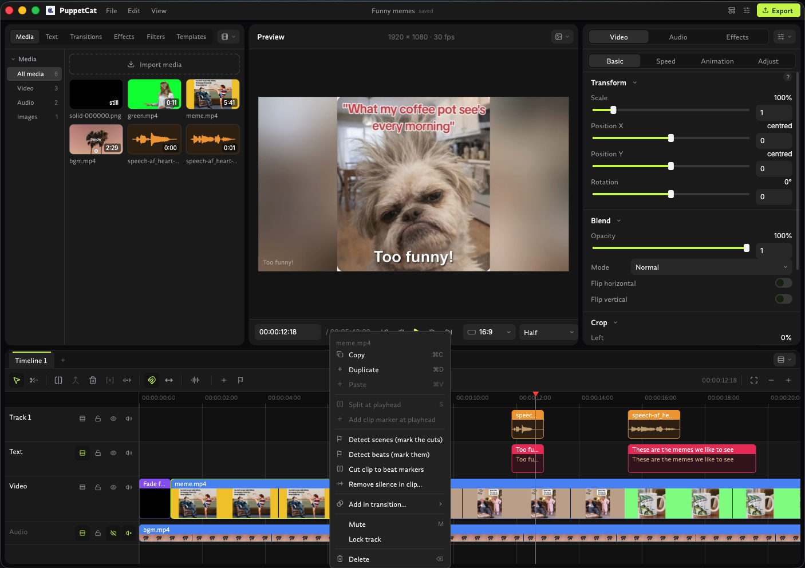

<div align="center">



# PuppetCat

**The open-source video editor your AI agent can actually use.**

Every feature is available to people in the window *and* to agents over MCP.

<p align="center">
  <a href="LICENSE"></a>
</p>



</div>

---

PuppetCat is a fork of [Concat](https://github.com/jub0t/Concat), an
open-source CapCut replacement. It does everything you use CapCut for —
without the watermarks, paywalls, or subscriptions. A native Rust engine does
the heavy lifting, a native interface does the editing, and it all runs on
your machine: install it and start cutting, no account, no extra downloads,
no setup.

**Where PuppetCat differs from Concat is who it is built for.** Concat is an
editor for a person at a window. PuppetCat is built to be operated by AI
agents just as well: the editor is not a GUI with an automation layer bolted
on. The window and the agent interface sit on the same engine and the same
commands, so whatever you can do by clicking, an agent can do over
[MCP](#built-for-agents) — and the other way round. Ask an agent to cut a
talking-head video to the beat, caption it, and queue the exports; open the
window and keep editing where it left off.

> [!NOTE]
> PuppetCat is one native Rust binary: the engine and the Slint editor window
> live together in [`engine/`](./engine). See
> [`engine/README.md`](./engine/README.md) to build it from source.

## Highlights

**Agent-first, on every feature.** Each item below is something you do in the
window *and* something an agent does through MCP.

- 🤖 **Agent-native by design** — the whole editor is exposed as MCP tools, not
  a thin subset. Agents drive a running window live, or work headless.
- 🎬 **Multi-track editing** — agents add tracks and place, move and
  trim clips, with several timelines per project
- ✂️ **The full cutting toolkit** — split, trim, merge, transitions and speed
  control, each one a tool call; `cut_to_beats` even cuts visuals to detected
  music beats in one step
- 💬 **Auto-captions** that run entirely on your machine — an agent can
  transcribe a clip, and your audio never leaves your computer
- 🗣️ **Local text-to-speech** — agents can narrate a cut without any cloud service
- 🎙️ **Voice filters** an agent can apply to clean up or play with sound
- 📝 **Titles and styled text** added and restyled programmatically
- 📦 **Templates and batch export** — build a layout once and reapply it, and
  have an agent queue many exports in a single batch
- ↩️ **Undoable, validated edits** — agent changes land in the same undo history
  as yours, and the timeline can be validated before export
- 📟 **A CLI too** for scripts and pipelines that don't need an agent
- 🚫 **No watermarks, no account, nothing behind a paywall**
- 🖥️ **Works the same on macOS, Windows and Linux**

## Built for agents

PuppetCat treats agentic editing as a first-class use, not an afterthought.

- **MCP server.** `puppetcat-agent-mcp` exposes the editor's operations —
  projects, import, timeline edits, effects, captions, speech, export — as
  [Model Context Protocol](https://modelcontextprotocol.io) tools that any
  MCP-capable agent (Claude Code, Codex, and others) can call. It runs headless
  or attaches to a running PuppetCat window, so you watch the agent's edits
  appear on your timeline as it makes them.
- **One implementation, two front ends.** Every feature lives in a shared host
  layer that the window and the MCP server both call, so nothing is UI-only. A
  feature isn't done until an agent can reach it.
- **Structured, undoable edits.** Agents change a project through the same
  command model the UI uses, including atomic multi-step edit plans, so their
  work shows up in undo history like anyone else's.
- **Local and private.** Transcription and speech run on your machine, so an
  agent can work on footage without uploading it anywhere.
- **CLI.** `puppetcat-cli` drives the engine without a window, for scripts and
  pipelines.

### Connect an agent

The MCP server speaks stdio. The macOS app bundle ships it at
`PuppetCat.app/Contents/MacOS/puppetcat-agent-mcp`, so installing a new
PuppetCat updates it too. Elsewhere, build it from source (see
[`engine/README.md`](./engine/README.md)). Point your agent at the binary,
for example in an MCP client config:

```json
{
  "mcpServers": {
    "puppetcat": {
      "command": "/path/to/puppetcat-agent-mcp"
    }
  }
}
```

If a PuppetCat window is open, the server forwards to it; otherwise it works on
its own. Then ask for what you want in plain language:

> *Make a new project, import everything in `~/Footage/trip`, cut the clips to
> the beat of `song.mp3`, add captions, and export 1080p.*

See [`ARCHITECTURE.md`](./ARCHITECTURE.md) for how the layers fit together.

## Get started

PuppetCat is currently in **Alpha (pre-release)**. Download the latest build from [Releases](https://github.com/optimusdag/puppetcat/releases).

**Platform support:**

- ✅ **macOS** — tested; unsigned binaries, so run:
  `xattr -dr com.apple.quarantine /Applications/PuppetCat.app`
- 🧪 **Windows** — builds are produced, but recent changes haven't been tested on it
- 🧪 **Linux**
  - 🧪 ARM
  - 🧪 x86_64
- 🚧 **Android**
  - Phones
  - Tablets
- 🚧 **iOS / iPadOS**
  - iPhone
  - iPad
- 🧪 **Raspberry Pi 5**

**Status:** ✅ Supported · 🚧 Work in progress · 🧪 To be tested

## Contribution

> [!IMPORTANT]
> The best way to contribute is to grab a build from the [Release](https://github.com/optimusdag/puppetcat/releases) page and test the application to see where it breaks or how it can be improved.

Ready to write code? [CONTRIBUTING.md](./CONTRIBUTING.md) covers setup, layout, the checks to run, and how contributions are licensed.

## Roadmap

Read [ROADMAP.MD](./ROADMAP.MD).

## License

PuppetCat is free software under the [GNU Affero General Public License v3.0 or
later](./LICENSE), inherited from Concat.

**If you just want to edit videos, none of this affects you.** Download a build
and use it for anything, including commercial work. There is nothing to accept,
register or pay, and no obligation attaches to you as a user.

**If you fork it, you are welcome here.** Modify it, ship it, sell it, host it.
The one condition is reciprocity: those who receive your version get the source
too, under the same license. That includes users who reach it over a network —
that is the "Affero" part, and it is why a hosted PuppetCat cannot be closed.

Two things sit alongside the AGPL:

- **Plugins keep their own license.** The [plugin
  exception](./LICENSE-EXCEPTIONS.md) means anything built on the PuppetCat API is
  yours to license as you like. The copyleft covers PuppetCat, not what talks to it.
- **The name is not part of the grant.** The code is free; *PuppetCat* and the logo
  identify builds from this project. Forks are encouraged — please ship them
  under your own name. See [TRADEMARK.md](./TRADEMARK.md).

Contributions are made under the [CLA](./CLA.md); you keep copyright in your
work. Distributed builds also include GPL-licensed FFmpeg and espeak-ng — see
[THIRD_PARTY_NOTICES.md](./THIRD_PARTY_NOTICES.md).
